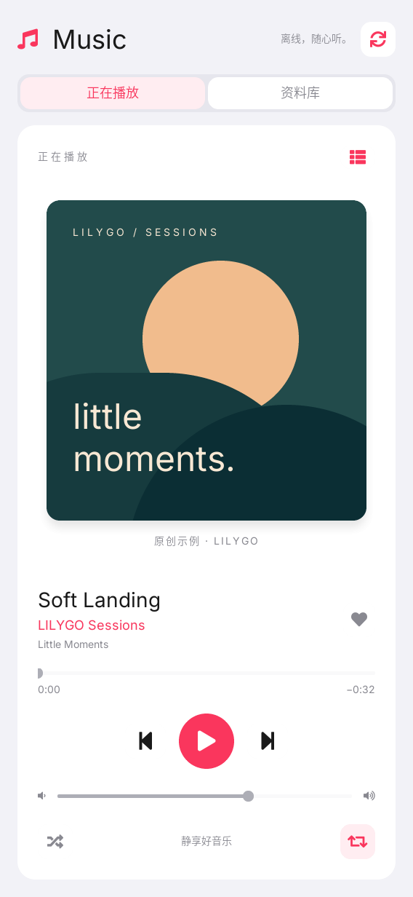
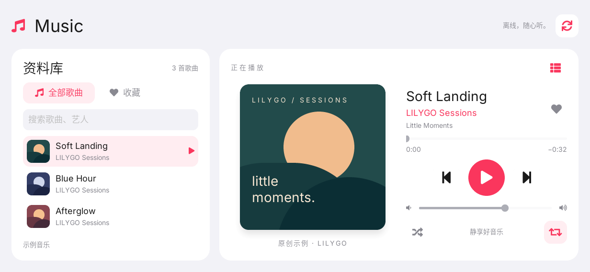

# LILYGO Music

**English** | [简体中文](README.zh-CN.md)

LILYGO Music is a local music player for LILYGO UI, built with C++17,
[LILYGO UI AppKit](https://github.com/LILYGO-UI/cm0-appkit), and LVGL 9.5.
It scans music stored on the device, uses mpv through its local IPC interface
for playback, and rearranges the library and player for portrait and landscape
layouts.

The project provides a CM0 ARM64 Linux build and an SDL2 desktop simulator for
development and testing. It does not require network access during playback.

## Preview

| Portrait · 568 × 1232 | Landscape · 1232 × 568 |
| --- | --- |
|  |  |

## Features

- **Local library:** scan a music directory recursively, derive track metadata
  from file names and folders, and rescan after files change.
- **Playback:** play and pause, skip to the previous or next track, seek through
  the timeline, and adjust volume.
- **Queue modes:** enable shuffle, cycle repeat modes, and browse favorites
  without changing the full playback queue.
- **Search and filters:** search titles, artists, and albums, then switch
  between all songs and favorites.
- **Responsive interface:** use the same LVGL view in portrait and landscape;
  wide layouts show the library and player together, while narrow layouts use
  Now Playing and Library tabs.
- **Persistent preferences:** save volume, shuffle, repeat, and favorite tracks
  under the user's XDG configuration directory.
- **Bundled samples:** include three original demo tracks and Espressif ADF
  format samples for development and device testing.

The default scan locations are $HOME/Music, /root/music, /mnt/sdcard/music,
/mnt/music, and /media/music. Set LILYGO_MUSIC_DIR to scan one explicit
directory. An explicit directory that is empty or missing produces an empty
library; built-in samples are used only when no default location contains music.
Scanning visits at most eight directory levels and keeps up to 2,048 tracks.

Supported file extensions are MP3, WAV, FLAC, M4A, AAC, OGG, Opus, AIFF, AIF, AC3,
MP4, TS, and WMA. Decoding and output capabilities come from the mpv executable
available on PATH. WAV durations can be read during the scan; other durations
are reported by mpv after playback starts.

Preferences are stored at $XDG_CONFIG_HOME/lilygo-ui-music/preferences, or at $HOME/.config/lilygo-ui-music/preferences when XDG_CONFIG_HOME is not set.

## Development Environment

Project identity, version, package metadata, and build output settings come
from lpm.toml. CMakePresets.json defines the host-simulator and cm0-cross
configurations. Run project commands from the repository root.

| Item | Value |
| --- | --- |
| Package / executable | lilygo-ui-music |
| Application ID | cc.lilygo.ui.Music |
| Version | 0.1.0 |
| License | MIT |
| Device architecture | AArch64 / ARM64 |

### Get the Source

```shell
git clone --recurse-submodules https://github.com/LILYGO-UI/lilygo-ui-music.git
cd lilygo-ui-music
```

For an existing checkout, initialize the pinned AppKit source SDK:

```shell
git submodule update --init --recursive
```

The application consumes AppKit from third_party/cm0-appkit through
find_package(LilyGoUI CONFIG REQUIRED). A separate binary AppKit installation
is not required for the simulator.

### Host Dependencies

Use CMake 3.21 or later, CTest and CPack, a C/C++17 compiler, make,
pkg-config, patch, SDL2, FreeType, LPM, and mpv. The simulator uses SDL2 for
its display and needs mpv on PATH when running playback tests or the application.

#### Debian 12 / Ubuntu 24.04 or Later

```shell
sudo apt update
sudo apt install build-essential cmake git pkg-config patch libsdl2-dev \
      libfreetype6-dev mpv ca-certificates python3 python3-venv python3-pip
```

#### macOS

Install the Xcode Command Line Tools if needed, then install dependencies with
[Homebrew](https://brew.sh/):

```shell
xcode-select --install
brew install git cmake pkg-config patch sdl2 freetype mpv python
```

Make sure Homebrew's bin directory is available on PATH.

#### LPM

CMake invokes lpm metadata --format cmake while configuring the project.
Install LPM in a project-local Python environment:

```shell
python3 -m venv .venv
. .venv/bin/activate
python -m pip install "git+https://github.com/LILYGO-UI/lpm.git"
lpm --version
```

Reactivate the environment with . .venv/bin/activate in each new terminal.
CMake searches .venv/bin as well as PATH; an existing LPM installation can
also be selected with -DLPM_EXECUTABLE=/absolute/path/to/lpm.

Check the host environment before building:

```shell
cmake --version
python --version
pkg-config --modversion sdl2 freetype2
lpm metadata --format cmake
mpv --version
```

### Device Cross Compiler

Skip this step when only building the desktop simulator. CM0 builds require an
AArch64 Linux cross compiler on the development machine.

**Debian / Ubuntu:**

```shell
sudo apt install gcc-aarch64-linux-gnu g++-aarch64-linux-gnu
```

**Apple Silicon macOS:**

```shell
brew install aarch64-unknown-linux-gnu
```

The BSP toolchain expects these executable names on PATH:

```shell
aarch64-linux-gnu-gcc --version
aarch64-linux-gnu-g++ --version
```

See [CM0BspBuilder](https://github.com/LILYGO-UI/CM0BspBuilder) for SDK host
and compiler requirements. The BSP supplies target headers and libraries, but
does not install the host cross compiler.

## Build and Test

### Desktop Simulator

Use LPM to configure, build, and start the simulator:

```shell
lpm start --foreground
```

To reuse an existing build without rebuilding:

```shell
lpm start --no-build --foreground
```

The simulator stores its build tree in build/host-simulator. To start it with
a specific music directory:

```
LILYGO_MUSIC_DIR="$HOME/Music" lpm start --no-build --foreground
```

Use the Library refresh button after adding or removing files.

### Tests

Configure and build the host simulator, then run the complete suite:

```shell
cmake --preset host-simulator
cmake --build --preset host-simulator --parallel
ctest --preset host-simulator
```

| Test | Coverage |
| --- | --- |
| music-core | Track scanning, queue transitions, shuffle/repeat, favorites, preferences, and real mpv IPC/error paths |
| music-view-model | Playback commands, filtering, search, time formatting, and LVGL Subject updates |
| music-render-portrait | Rendering and interaction at 568 × 1232 |
| music-render-landscape | Rendering and interaction at 1232 × 568 |

Render tests write music-portrait.ppm and music-landscape.ppm under
build/host-simulator. Inspect both images after UI changes; passing assertions
do not replace visual inspection.

### CM0 Device Build

The device preset targets CM0 Raspberry Pi OS on AArch64, uses a Release build,
disables host tests, and installs under /usr. Cross-compile and create the
Debian package with:

```shell
cmake --preset cm0-cross
cmake --build --preset cm0-cross --parallel
cpack --config build/cm0-cross/CPackConfig.cmake -B dist
```

The first configuration downloads CM0 BSP 0.1.0, verifies its pinned SHA-256,
and caches the sysroot under .cache/cm0-bsp/. Later builds reuse that cache.
The first download requires GitHub access. Change the cache location with
-DCM0_BSP_CACHE_DIR=/absolute/path/to/cache.

The resulting ARM64 .deb is written to dist/. It installs the executable,
Launcher manifest, icon, desktop/AppStream metadata, and shared-font license
notices. It does not include assets/audio/ or preview images. The target must
provide runtime dependencies including mpv and lilygo-ui-appkit-dev >= 0.1.0;
upload music files separately to the target user's Music directory.

<details>
<summary>Underlying CMake commands</summary>

    cmake --preset host-simulator
    cmake --build --preset host-simulator --parallel
    ctest --preset host-simulator

    cmake --preset cm0-cross
    cmake --build --preset cm0-cross --parallel
    cpack --config build/cm0-cross/CPackConfig.cmake -B dist

</details>

### Troubleshooting

| Symptom | Action |
| --- | --- |
| lpm is required to read project metadata | Activate .venv, put LPM on PATH, or set LPM_EXECUTABLE. |
| LilyGoUI or LVGL cannot be found | Run git submodule update --init --recursive and configure from the repository root. |
| SDL2 or FreeType is missing | Install host development packages; for cross builds, check the target sysroot. |
| Homebrew libraries are not found | Configure with cmake --preset host-simulator -DCMAKE_PREFIX_PATH="$(brew --prefix)". |
| mpv not found or playback fails | Install mpv, verify it is on PATH, and check the audio output device. |
| The library is empty | Check LILYGO_MUSIC_DIR and the default locations. An explicitly empty directory intentionally stays empty. |
| Device packaging cannot download the BSP | Check GitHub access and disk space, then rerun the cm0-cross configuration. |

## Documentation

| Guide | Contents |
| --- | --- |
| [Architecture overview](docs/00-overview.md) | Build contract, project metadata, workflow, and repository structure |
| [UI development guidelines](docs/01-user-interface.md) | MVVM boundaries, responsive layout, typography, lifecycle, and UI validation |
| [Music implementation notes](docs/02-music.md) | Layout behavior, scanning, preferences, mpv IPC, and verification details |
| [Demo audio notes](assets/audio/README.md) | Included samples, generation script, and third-party audio attribution |

## Acknowledgments

The application uses [LILYGO UI AppKit](https://github.com/LILYGO-UI/cm0-appkit),
[LVGL](https://lvgl.io/), and [mpv](https://mpv.io/). The interface and playback
behavior were informed by the music application in
[T-Display-K230](https://github.com/Xinyuan-LilyGO/T-Display-K230/tree/main/k230_launcher),
but this project has an independent C++ MVVM implementation and does not copy
that Launcher's source or audio pipeline.

The three Little Moments WAV files are original demo material. The long
two-channel samples are distributed by the
[Espressif ADF Audio Samples](https://docs.espressif.com/projects/esp-adf/en/latest/audio-samples.html#two-channel-audio)
documentation and retain the attribution described in
[assets/audio/README.md](assets/audio/README.md).
